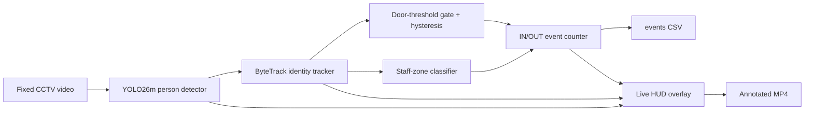

# CCTV people counting

This project counts doorway crossings in the supplied fixed-camera store video. It writes:

- `output/annotated_yolo26_door.mp4`: bounding boxes, ByteTrack IDs, doorway line, IN/OUT totals, and live headcount.
- `output/events_yolo26_door.csv`: `timestamp,person_id,event,headcount`.
- `APPROACH.md`: the one-page approach and limitations note.
- `approach_note.pdf`: PDF submission covering the approach, limitations, future work, and edge cases.
- `presentation_script.md`: approximately two-minute explanation script for the submission/demo.

## Architecture

The diagram below was authored as Mermaid syntax and can be edited or exported with
[Mermaid Editor](https://www.mermaideditor.io/?utm_source=youtube&utm_medium=video&utm_campaign=github-readme).



## Deliverables

The final generated files are available under `output/`:

| File | Description |
|---|---|
| `annotated_yolo26_door.mp4` | H.264 annotated video with boxes, IDs, door line, customer/staff labels, and live HUD |
| `events_yolo26_door.csv` | One row per event: `timestamp,person_id,event,headcount` |
| `events_yolo26_staff.csv` | Earlier staff-zone run retained for comparison |

## Run

Requires Python 3.12+, `ffmpeg` is not required by the script, and a CPU or CUDA-capable machine.

## Models and libraries used

- **YOLO26m (`yolo26m.pt`)** — open-source Ultralytics detector, restricted to the COCO `person` class. The medium model was selected for higher detection quality than the small model; `yolo26s.pt` is available for faster CPU runs.
- **ByteTrack** — Ultralytics multi-object tracker used to maintain person IDs through short detector gaps and occlusions.
- **OpenCV** — video decoding/encoding, drawing boxes, IDs, doorway line, staff zone, and HUD.
- **NumPy** — polygon and geometry operations for the doorway and staff-zone logic.
- **Python standard library** — CSV writing, command-line arguments, file handling, and event state.
- **Mermaid** — architecture diagram embedded in this README; it can be edited/exported with Mermaid Editor.

The counting logic is custom code in `people_counter.py`: doorway threshold crossing, hysteresis, stable-side dwell, cooldown, initial occupancy warm-up, customer/staff zone classification, and live headcount reconciliation.

### AI assistance

The implementation and documentation were developed with AI coding assistance. The runtime used here selects the underlying model automatically, so an exact underlying model name is not asserted in the repository. If your submission requires the requested label, describe the assistance as **GPT-5.6-Luna requested by the project owner**, while the reproducible runtime dependency remains the open-source YOLO26m + ByteTrack pipeline above.

```bash
python3.12 -m venv .venv
.venv/bin/pip install -r requirements.txt
.venv/bin/python people_counter.py \
  --input "/path/to/720p.mp4" \
  --output-video output/annotated.mp4 \
  --output-csv output/events.csv
```

The default run uses the higher-accuracy open-source `yolo26m.pt` model from Ultralytics. For a faster run use `--model yolo26s.pt`; for GPU use `--device 0`. Model weights are downloaded automatically by Ultralytics and are intentionally not committed to this repository.

The default doorway line is placed at the lower-right door threshold, closer to the physical door than the mat interior, in the supplied 1270x720 clip (`900,720;1260,500`). The first two seconds are treated as initial occupancy rather than new entries. The default cashier/staff polygon is `0,0;210,0;210,500;0,500`; tracks persistently observed there are orange `STAFF` and excluded from customer totals. Adjust it with `--line x1,y1;x2,y2` or `--staff-polygon "x1,y1;x2,y2;x3,y3;..."` if the camera or layout changes.

## Design choices

Only the COCO `person` class is tracked. ByteTrack maintains identities through short detector misses and occlusions. A crossing requires multiple consecutive observations on the new side of the line, and a per-track cooldown prevents line jitter from double counting. The headcount is the cumulative `IN` count minus `OUT` count, never below zero.

Staff are separated with a persistent cashier-zone rule, not clothing appearance: tracks observed in the default left cashier polygon for at least 0.75 seconds and 35% of their visible frames are marked `STAFF` in orange and excluded from customer IN/OUT totals. All other tracks are `CUSTOMER` in green. This remains a heuristic; a staff roster or trained appearance/ReID classifier is needed for production-grade identity classification.
